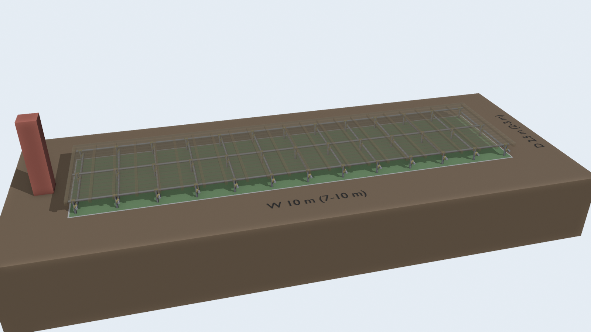
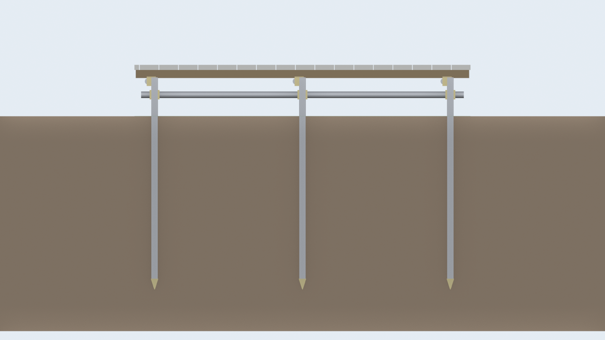
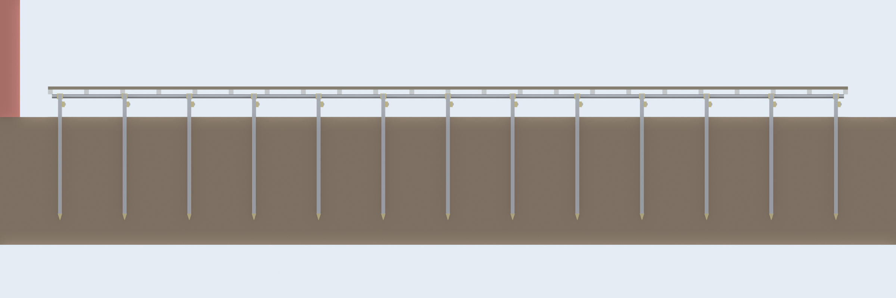
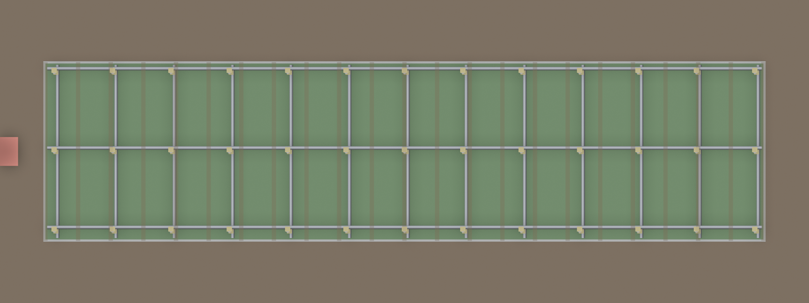

# パイプ台 の見積

単管を切った杭(先端キャップ付き)と単管の梁に、赤松の根太と 2×6 の床板を張る台。床いっぱいに人が乗っても持つ杭の配置。



断面X: 杭の列で切り、横(x 方向)から見る



断面Y: 真ん中の杭の行で切り、前(y 方向)から見る



断面Z: 根太の高さで切って床板を外し、上から見る



図の木(根太・床板)は半透明にして、下のパイプが見えるようにした。

## 部材(標準 10m × 2.5m)

| 品目                       |   数量 | 単価(税込) |      小計 | 内訳                                                      |
| -------------------------- | -----: | ---------: | --------: | --------------------------------------------------------- |
| 単管打込みキャップ 先端    |  39 個 |      276円 |  10,764円 | 杭1本に1個。13列×3行、地中 1.21m 打ち込み                 |
| 単管パイプ φ48.6×1.8×4000  |  34 本 |    2,508円 |  85,272円 | 切り出し 4.00m×6・2.40m×13・1.90m×3・1.50m×39(端材 16.6m) |
| 兼用自在クランプ 48.6/42.7 |  78 個 |      382円 |  29,796円 | 杭と梁・杭とつなぎの交点                                  |
| 単管ジョイント             |   6 個 |      520円 |   3,120円 | 梁の継ぎ                                                  |
| 根太止め金具(単管-木材)    |  69 個 |      330円 |  22,770円 | 根太と梁の交点                                            |
| 赤松 乾燥材 60×60×2985     |  23 本 |    2,178円 |  50,094円 | 切り出し 2.48m×23(端材 11.6m)                             |
| SPF 2×6 38×140×3650        |  54 本 |    4,928円 | 266,112円 | 切り出し 3.64m×9・3.61m×27・2.74m×9・1.39m×18(端材 17.1m) |
| コーススレッド 75mm        | 918 本 |        4円 |   3,672円 | 床板1枚・根太1本あたり2本                                 |
| 合計                       |        |            | 471,600円 | 1m² あたり 18,864円                                       |

## 量

| 項目               | 量      |
| ------------------ | ------- |
| 鉄(単管+杭)        | 248 kg  |
| 単管の切断         | 55 か所 |
| 木材(使う分の体積) | 1.12 m³ |
| 床の高さ           | 0.38 m  |

## 杭に既製のパイプ杭を使う場合(標準 10m × 2.5m)

単管を切る代わりに、既製のパイプ杭(1.5m)を買う。上の案より 32,994円高い。

| 品目                       |   数量 | 単価(税込) |      小計 | 内訳                                                      |
| -------------------------- | -----: | ---------: | --------: | --------------------------------------------------------- |
| パイプ杭 φ48.6×1500        |  39 本 |    1,958円 |  76,362円 | 13列×3行、地中 1.21m 打ち込み                             |
| 単管パイプ φ48.6×1.8×4000  |  21 本 |    2,508円 |  52,668円 | 切り出し 4.00m×6・2.40m×13・1.90m×3(端材 23.1m)           |
| 兼用自在クランプ 48.6/42.7 |  78 個 |      382円 |  29,796円 | 杭と梁・杭とつなぎの交点                                  |
| 単管ジョイント             |   6 個 |      520円 |   3,120円 | 梁の継ぎ                                                  |
| 根太止め金具(単管-木材)    |  69 個 |      330円 |  22,770円 | 根太と梁の交点                                            |
| 赤松 乾燥材 60×60×2985     |  23 本 |    2,178円 |  50,094円 | 切り出し 2.48m×23(端材 11.6m)                             |
| SPF 2×6 38×140×3650        |  54 本 |    4,928円 | 266,112円 | 切り出し 3.64m×9・3.61m×27・2.74m×9・1.39m×18(端材 17.1m) |
| コーススレッド 75mm        | 918 本 |        4円 |   3,672円 | 床板1枚・根太1本あたり2本                                 |
| 合計                       |        |            | 504,594円 | 1m² あたり 20,184円                                       |

| 項目               | 量      |
| ------------------ | ------- |
| 鉄(単管+杭)        | 280 kg  |
| 単管の切断         | 16 か所 |
| 木材(使う分の体積) | 1.12 m³ |
| 床の高さ           | 0.38 m  |

杭は既製のパイプ杭(1.5m、3.94kg)を買って打ち込む。単管より重く、先が尖っていて打ち込みやすい。

## 強さの確かめ

床いっぱいに人が乗っても(1.8kN/m²、床の重さ 0.3kN/m² を足す)持つように、杭の配置を決めた。構造は杭・単管の梁・根太・床板だけで、筋交いや二重の梁は使わない。

合格の条件は次の 3 つ。その中で一番安い配置にした。表の比は 1 以下で合格。

- 単管の梁と赤松の根太が、長期許容曲げ応力以内(単管 237N/mm²、赤松 9.7N/mm²)
- たわみがスパンの 1/300 以内
- 杭1本の荷重が、自在クランプ1個で支えられる 2.45kN 以内

| 案                                    | 杭の配置(列×行) | 杭の間隔(横×縦) | 梁の曲げ | 梁のたわみ | 根太の曲げ | 根太のたわみ |  杭1本の荷重 |
| ------------------------------------- | --------------- | --------------- | -------: | ---------: | ---------: | -----------: | -----------: |
| この設計(10m × 2.5m)                  | 13×3            | 0.81m × 1.10m   |     0.33 |       0.40 |       0.41 |         0.57 | 2.33kN(0.95) |
| 縦を変えた場合(10m × 2m)              | 10×3            | 1.08m × 0.85m   |     0.46 |       0.73 |       0.25 |         0.27 | 2.40kN(0.98) |
| 縦を変えた場合(10m × 3m)              | 11×4            | 0.97m × 0.90m   |     0.39 |       0.57 |       0.28 |         0.31 | 2.29kN(0.94) |
| 杭を 1.8m 間隔にした前の案(8m × 2.5m) | 6×3             | 1.54m × 1.10m   |     1.21 |       2.77 |       0.41 |         0.57 | 4.45kN(1.82) |
| 元の案の杭 4×3(10m × 2.5m)            | 4×3             | 3.23m × 1.10m   |     5.34 |      25.63 |       0.41 |         0.57 | 9.34kN(3.81) |

### 横 10m で縦を変えた場合の合計

| 縦   | 杭の配置       | 合計(単管を切る) | 合計(既製のパイプ杭) |
| ---- | -------------- | ---------------: | -------------------: |
| 2m   | 10×3(杭 30 本) |        387,240円 |            400,080円 |
| 2.5m | 13×3(杭 39 本) |        471,600円 |            504,594円 |
| 3m   | 11×4(杭 44 本) |        552,962円 |            571,794円 |

### 強さの注意

- 梁と根太は単純梁として計算した。実際は継ぎ目の無い所で連続梁になるので、もう少し余裕がある。
- クランプの許容 2.45kN は一般的な値で、買う品の表示を確かめていない。表示が低ければ、梁の下にもう1個クランプを付けて受ける。
- 杭1本の荷重(約 240kg)を地面が支えられるかは、土によって違う。柔らかい土だと沈む。1 本試しに打ち込み、3 人くらい乗って沈まないか確かめる。
- 射手が 1m おきに並ぶだけなら荷重はこの半分以下で、さらに余裕がある。

## サイズ別の合計

| サイズ    |  面積 | 合計(税込) | 1m² あたり | 杭に既製のパイプ杭を使う場合 |
| --------- | ----: | ---------: | ---------: | ---------------------------: |
| 7m × 2m   | 14 m² |  275,608円 |   19,686円 |                    285,880円 |
| 8m × 2.5m | 20 m² |  371,368円 |   18,568円 |                    399,286円 |
| 10m × 3m  | 30 m² |  552,962円 |   18,432円 |                    571,794円 |

## 前提と含まないもの

- 杭は単管を 1.5m に切り、先端に打込みキャップを付けて打ち込む。単管は肉厚 1.8mm で、既製のパイプ杭(1.5m で 3.94kg)より軽い(約 3.1kg)。硬い地盤だと頭が潰れやすいので、打つときは頭に当て木をする。
- 杭は地中に約1.2m打ち込む前提。地盤が柔らかいと沈む・傾く。
- 赤松・SPF は屋外で腐りやすい。防腐塗料(未計上)を塗るか、床板をウッドデッキ材に替える。
- 単管の切断はホームセンターのカットサービス(料金未計上)を使う前提。
- 工具・運搬・人手、作業中に出る予備の部材は含まない。
- 写真の値札に無かった品目は仮の単価(一覧は 共通/見積まとめ.md)。共通/shooting.py の PRICES を直すと作り直せる。

## 作り直し方

```sh
blender -b --python 計画/パイプ台/build.py
```
