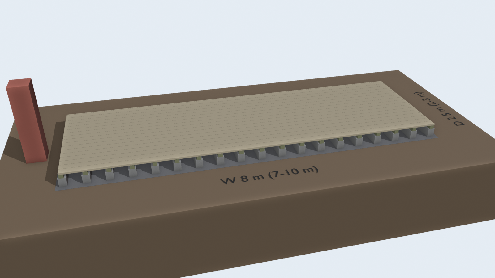
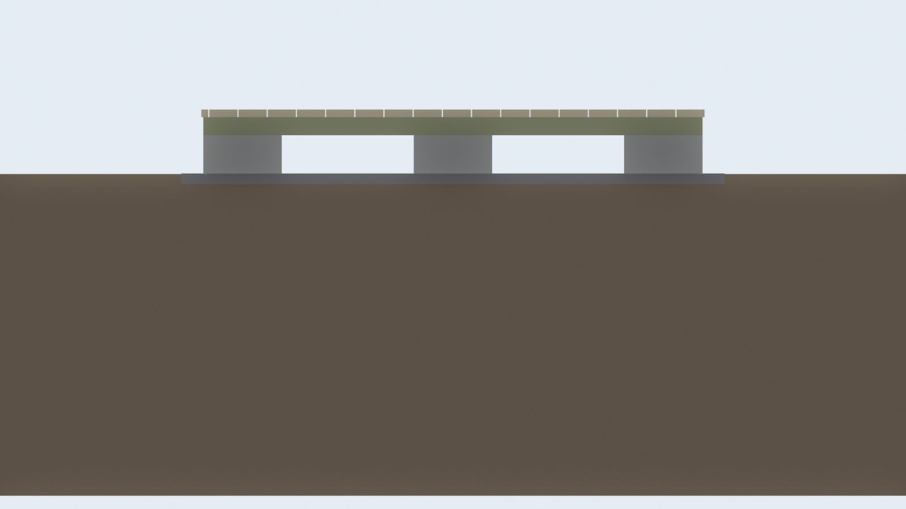

# ブロック の見積

砕石を敷き、ブロックを並べて防腐角材の根太と 2×6 の床板を張る。





## 部材(標準 8m × 2.5m)

| 品目 | 数量 | 単価(税込) | 小計 | 内訳 |
|---|---:|---:|---:|---|
| 砕石 20kg | 89 袋 | 260円 | 23,140円 | 厚さ 5cm、1.11 m³ |
| 重量ブロックC 390×150×190 | 57 個 | 305円 | 17,385円 | 根太1本に 3 個 |
| 防腐加工 角材 90×90×3000 | 19 本 | 4,928円 | 93,632円 | 切り出し 2.48m×19(端材 9.9m) |
| SPF 2×6 38×140×3650 | 41 本 | 4,928円 | 202,048円 | 切り出し 3.56m×9・3.52m×18・2.68m×9・1.80m×9・0.92m×9(端材 5.7m) |
| コーススレッド 75mm | 756 本 | 4円 | 3,024円 | 床板1枚・根太1本あたり2本 |
| 合計 | | | 339,229円 | 1m² あたり 16,961円 |

## 量

| 項目 | 量 |
|---|---|
| 砕石 | 1.11 m³(約 1.8 t) |
| ブロック | 57 個(約 798 kg) |
| 木材(使う分の体積) | 1.12 m³ |
| 掘削・すき取り | 1.11 m³ |
| 床の高さ | 0.32 m |

## サイズ別の合計

| サイズ | 面積 | 合計(税込) | 1m² あたり |
|---|---:|---:|---:|
| 7m × 2m | 14 m² | 256,027円 | 18,288円 |
| 8m × 2.5m | 20 m² | 339,229円 | 16,961円 |
| 10m × 3m | 30 m² | 490,208円 | 16,340円 |

## 前提と含まないもの

- 地面を 5cm すき取って砕石を敷き、ブロックを水平に据える前提。ブロックと根太は固定しない置き基礎。
- 根太は地面に近いので防腐材にした。赤松 60×60 にすると根太代は半分以下になるが、腐りやすい。
- 床板の SPF は屋外で腐りやすい。防腐塗料は未計上。
- 工具・運搬・人手、作業中に出る予備の部材は含まない。
- 写真の値札に無かった品目は仮の単価(一覧は 共通/見積まとめ.md)。共通/shooting.py の PRICES を直すと作り直せる。

## 作り直し方

```sh
blender -b --python 計画/ブロック/build.py
```
