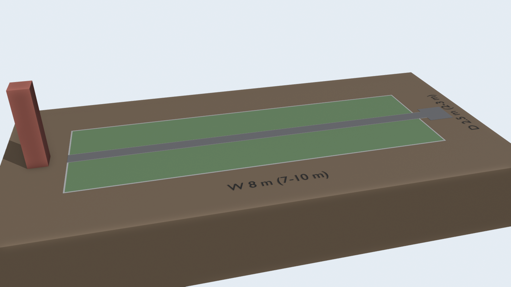
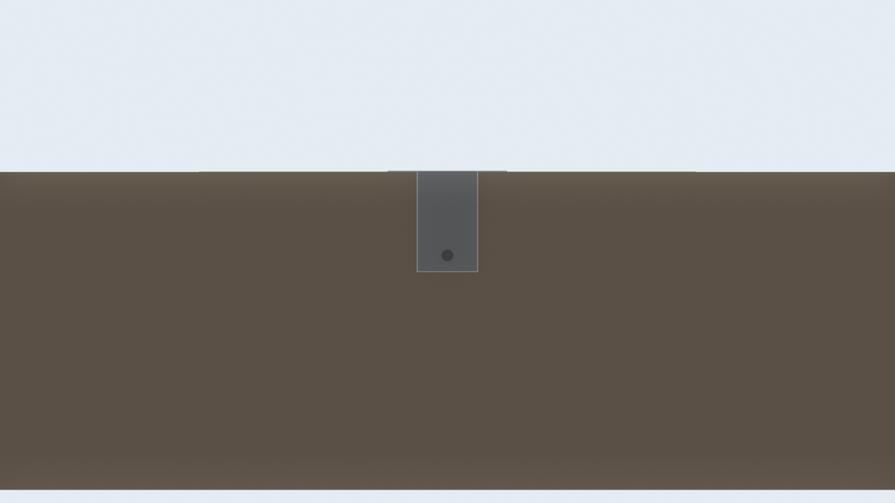

# 排水作戦 の見積

溝を掘って暗渠管と砕石を入れ、端の浸透ますへ水を逃がす。





## 部材(標準 8m × 2.5m)

| 品目 | 数量 | 単価(税込) | 小計 | 内訳 |
|---|---:|---:|---:|---|
| 砕石 20kg | 128 袋 | 260円 | 33,280円 | 1.59 m³ × 1.6 t/m³ |
| 透水シート 1m×10m | 2 巻 | 1,980円 | 3,960円 | 16.2 m² + 重ね代1割 |
| 有孔管(暗渠管) φ50×4m | 3 本 | 1,650円 | 4,950円 | 切り出し 4.00m×2・0.50m×1(端材 3.5m) |
| 合計 | | | 42,190円 | 1m² あたり 2,110円 |

## 量

| 項目 | 量 |
|---|---|
| 掘削・残土 | 1.59 m³(約 2.9 t) |
| 砕石 | 1.59 m³(約 2.5 t) |
| 溝 | 幅 0.3m × 深さ 0.5m × 長さ 8.2m |
| 浸透ます | 0.6m 角 × 深さ 1.0m(エリアの右端の外) |

## サイズ別の合計

| サイズ | 面積 | 合計(税込) | 1m² あたり |
|---|---:|---:|---:|
| 7m × 2m | 14 m² | 37,420円 | 2,673円 |
| 8m × 2.5m | 20 m² | 42,190円 | 2,110円 |
| 10m × 3m | 30 m² | 50,410円 | 1,680円 |

## 前提と含まないもの

- 台は作らず、地面の水はけだけを良くする案。上に床が要るなら他の案と組み合わせる。
- 地面を溝に向けて少し勾配を付ける前提(作業のみ)。粘土質で地下に浸みない土だと、浸透ますが溢れて効かない。
- 掘った土(残土)の処分費は未計上。砕石は量が多いので、袋より業者のバラ配達が安いことがある。
- 工具・運搬・人手、作業中に出る予備の部材は含まない。
- 写真の値札に無かった品目は仮の単価(一覧は 共通/見積まとめ.md)。共通/shooting.py の PRICES を直すと作り直せる。

## 作り直し方

```sh
blender -b --python 計画/排水作戦/build.py
```
