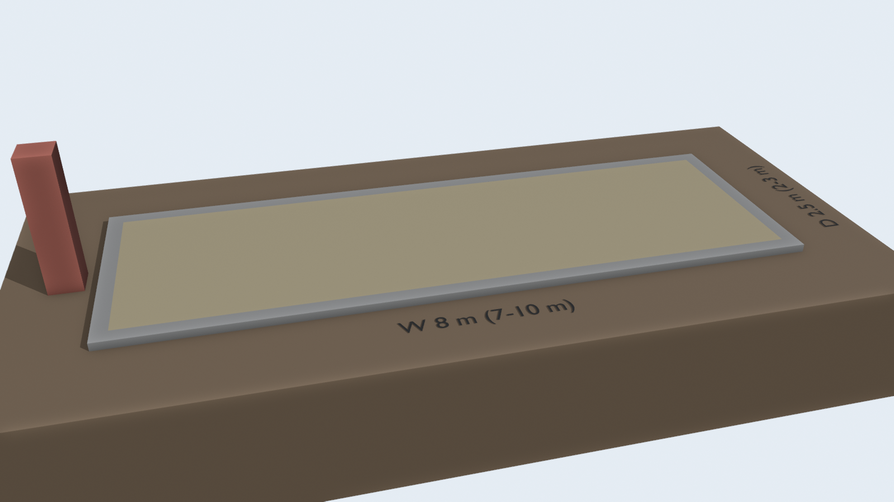
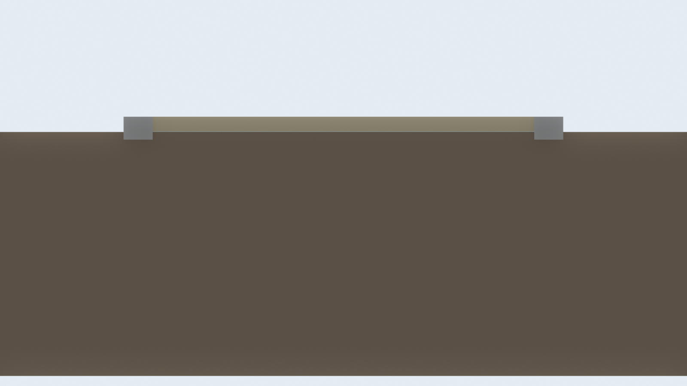

# 砂 の見積

透水シートの上に砂を 10cm 敷いて嵩上げし、周りをブロックで留める。





## 部材(標準 8m × 2.5m)

| 品目 | 数量 | 単価(税込) | 小計 | 内訳 |
|---|---:|---:|---:|---|
| 砂 20kg | 160 袋 | 330円 | 52,800円 | 厚さ 10cm、2.00 m³ |
| 透水シート 1m×10m | 3 巻 | 1,980円 | 5,940円 | 20.0 m² + 重ね代1割 |
| 重量ブロックC 390×150×190 | 58 個 | 305円 | 17,690円 | 寝かせて周囲を囲う |
| 合計 | | | 76,430円 | 1m² あたり 3,822円 |

## 量

| 項目 | 量 |
|---|---|
| 砂 | 2.00 m³(約 3.2 t) |
| ブロック | 58 個(約 812 kg) |
| 掘削(ブロックの据え付け) | 0.20 m³ |
| 仕上がり高さ | 0.10 m |

## サイズ別の合計

| サイズ | 面積 | 合計(税込) | 1m² あたり |
|---|---:|---:|---:|
| 7m × 2m | 14 m² | 56,170円 | 4,012円 |
| 8m × 2.5m | 20 m² | 76,430円 | 3,822円 |
| 10m × 3m | 30 m² | 108,800円 | 3,627円 |

## 前提と含まないもの

- 床は作らず、砂で 10cm 嵩上げして水たまりを避ける案。雨で砂が締まって減るので、たまに足す。
- 砂は量が多く、袋で買うと重い。業者のバラ配達(料金未調査)の方が安くて楽なことがある。
- シートは泥と砂が混ざるのを防ぐ。地面自体の水はけが悪いと、砂の下に水が溜まる。
- 工具・運搬・人手、作業中に出る予備の部材は含まない。
- 写真の値札に無かった品目は仮の単価(一覧は 共通/見積まとめ.md)。共通/shooting.py の PRICES を直すと作り直せる。

## 作り直し方

```sh
blender -b --python 計画/砂/build.py
```
