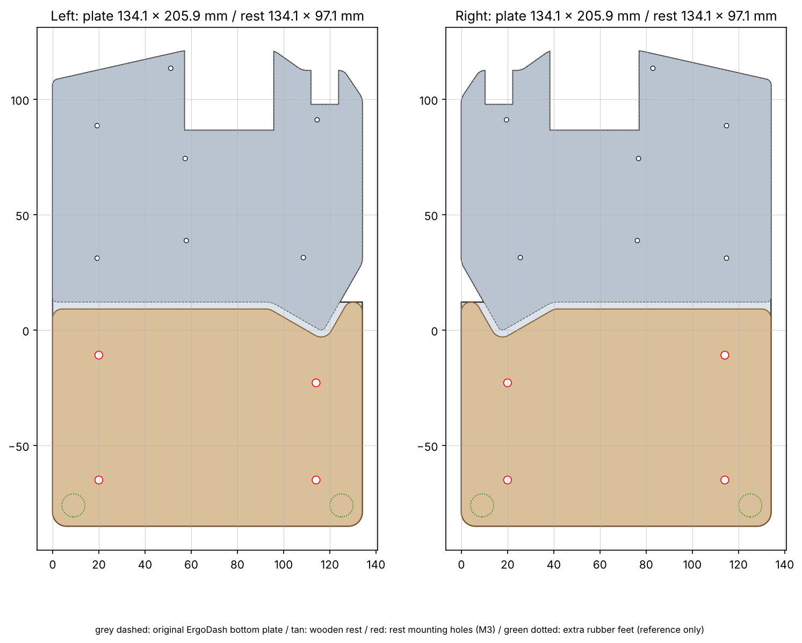

# ErgoDash パームレスト一体ボトムプレート

ErgoDash (rev1.2) のボトムプレートを手前に約 85mm 延ばし、その上に木のパームレストをねじで留める。
キーボードとレストが一枚のプレートに載るので、使っているうちにずれない。



## ファイル

| ファイル | 中身 |
| --- | --- |
| `make_plate.py` | 生成スクリプト。寸法は先頭のパラメータで変える |
| `ergodash_rev1.2_bottom.json` | 元のボトムプレートの外形と穴 (omkbd/ErgoDash `Case/rev1.2/ergodash-rev1-2.svg` から抽出, MIT, (c) 2018 omkbd) |
| `out/plate_L.dxf`, `out/plate_R.dxf` | プレートの切り出し用 (外形と穴のみ, レイヤー `CUT`, mm) |
| `out/rest_L.dxf`, `out/rest_R.dxf` | 木のレストの外形と下穴位置 (原寸の型紙) |
| `out/preview.png` | 確認用の図 |

```
pip install shapely ezdxf matplotlib
python make_plate.py
```

## 寸法 (既定値)

- プレート: 134.1 x 205.9 mm x 2 枚 (L/R は左右反転)
- レスト: 134.1 x 97.1 mm x 2 個。キーボードとのすき間 3mm
- レストの留め穴: M3 用 3.4mm x 4 か所
- 元のスペーサー穴 (M2) は元データの径 (約 1.95mm) のまま。発注先がカーフ補正しない場合は `SPACER_HOLE_D = 2.2` にする

## 組み立てのメモ

- レストは下からプレート越しに M3 で留める。木には鬼目ナットか木用インサートナットを埋める (木ねじでも可)
- ねじの頭がプレートの下に出るので、皿ねじ + 皿もみ (アクリル 3mm 以上) か、極低頭ねじ + 頭より高いゴム足にする
- 延ばした先の下にもゴム足を足す (図の緑の点線)。無いとプレートがしなる
- レストの厚みは、キーボード手前の高さからプレートの厚みを引いた値を目安にする
- 図は上から見たもの。皿もみをする場合は L/R を取り違えないこと
